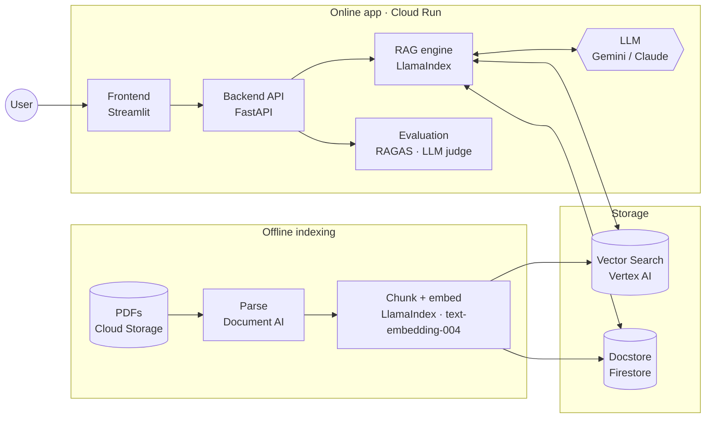
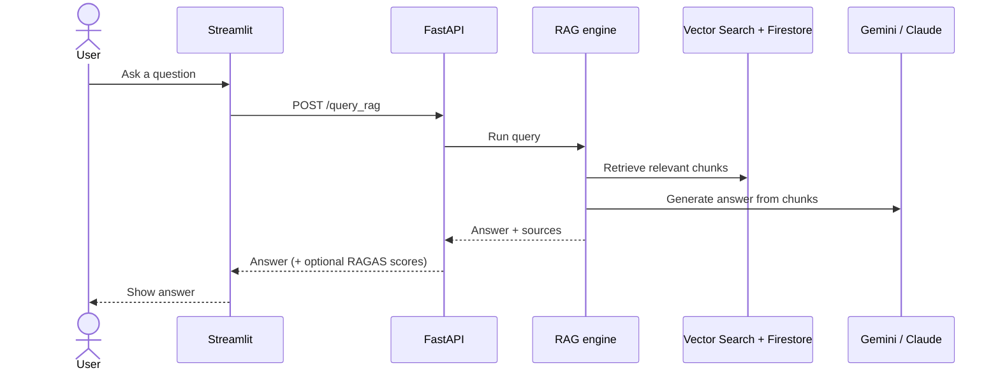

# RAG-Study: AI Assistant Architecture & Tooling

## 1. What the assistant is

RAG-Study is an **agentic Retrieval-Augmented Generation (RAG) assistant** for **engineering codes and standards**. It answers technical questions using a corpus of PDF documents. Its system prompt sets it up as *"a highly professional and experienced engineer"* who gives concise, accurate answers and reads markdown tables taken from the source documents.

It is also an **experimentation and evaluation workbench**. From the UI you can switch indexes, edit prompts, turn retrieval techniques (HyDE, re-ranking, hybrid search and so on) on or off, and score answer quality on single queries or on a whole ground-truth dataset.

The system has three parts:

| Part | Location | Runs as |
|---|---|---|
| **Offline indexing pipeline**: parse PDFs, chunk them, embed them, write the indexes | `backend/indexing/` | Script / Jupyter notebook, run by hand |
| **Backend RAG API**: retrieval, generation, agent, evaluation | `backend/app/`, `backend/rag/` | FastAPI + Uvicorn container on Cloud Run |
| **Frontend UI**: data-source picker, prompt editor, chatbot, batch evals | `ui/` | Streamlit container on Cloud Run |

Both services share their settings through `common/config.yaml`.

---

## 2. Flowchart: key components and tools

### Request path (one chat question)

The RAG engine adds optional steps around retrieval: a ReAct agent, HyDE, hybrid BM25 search, question-index lookup and LLM re-ranking. Section 3.3 describes each one.

---

## 3. Component details

### 3.1 Offline indexing pipeline: `backend/indexing/`

| Step | What happens | Tool / library |
|---|---|---|
| 1. Source | List and download PDFs from the GCS bucket `ai-sandbox-jacobs_dataset/raw_dataset/` | `google-cloud-storage` (transfer manager) |
| 2. Parse | Batch-parse PDFs with layout awareness (headings, tables) and Document AI chunking (`chunk_size=512`, ancestor headings included) | **Google Document AI** Layout Parser (`docai_parser.py`) |
| 3. Chunk | Build a **parent/child hierarchy** of nodes at 4096 → 2048 → 1024 → 512 tokens. A flat `SentenceSplitter` mode is also available. | LlamaIndex `HierarchicalNodeParser` |
| 4. Question generation | For each document, an LLM writes 5 questions the document answers, then parses them into a Pydantic list | LlamaIndex `QuestionsAnsweredExtractor`, `LLMTextCompletionProgram`, **Gemini 1.5 Pro** |
| 5. Embed | Embed the leaf (512-token) nodes and the generated questions | **Vertex AI `text-embedding-004`** |
| 6. Store | Leaf vectors go to the base Vector Search index. Question vectors go to a separate "questions-answered" index. **All** nodes (parents and children) go to the Firestore docstore, so they can be merged back together at query time. | **Vertex AI Vector Search** (Tree-AH, `STREAM_UPDATE`), **Firestore** (`llama-index-storage-docstore-firestore`) |

`vector_search_utils.py` creates or reuses the Vector Search index and endpoint and deploys the index (`aiplatform.MatchingEngineIndex` / `MatchingEngineIndexEndpoint`).

### 3.2 Backend API: `backend/app/`

FastAPI app (`main.py`) with four routers. At startup it creates a singleton **`IndexManager`** and **`Prompts`** (`shared_state.py`) and injects them with `Depends`, so changes made in the UI apply to later requests.

| Endpoint | Purpose |
|---|---|
| `GET /list_vector_search_indexes_and_endpoints` | Lists Vertex Vector Search indexes and endpoints |
| `GET /list_firestore_databases`, `POST /list_firestore_collections` | Lists Firestore DBs and namespaces (Firestore Admin API) |
| `GET /get_current_index_info`, `POST /update_index` | Reads or changes the active base index, QA index and docstore |
| `GET /get_all_prompts`, `POST /update_prompt` | Reads or edits prompt templates at runtime |
| `POST /query_rag` | Full RAG / agent pipeline, with optional RAGAS scoring |
| `POST /query_rag_test` | Plain vector retrieval only. Returns raw scored nodes with no LLM answer. |
| `POST /eval_batch` | Runs a ground-truth CSV from GCS through the pipeline, then scores it with LLM-as-judge and RAGAS |

Request models (`models.py`) expose the experiment settings: `llm_name`, `temperature`, `similarity_top_k`, `retrieval_strategy`, `use_hyde`, `use_refine`, `use_node_rerank`, `use_react`, `qa_followup`, `hybrid_retrieval`.

### 3.3 RAG engine: `backend/rag/`

`IndexManager.get_query_engine()` builds the pipeline from those settings. Each technique can be switched on or off:

| Technique | File / class | Notes |
|---|---|---|
| **Auto-merging retrieval** (default) | LlamaIndex `AutoMergingRetriever` | If enough sibling leaf chunks match, it swaps them for their parent chunk from Firestore |
| **Parent retrieval** | `parent_retriever.py` → `ParentRetriever` | Groups hits by source document, averages their scores and returns the whole source doc |
| **Baseline** | `VectorIndexRetriever` | Plain top-k vector search |
| **QA follow-up retrieval** | `qa_followup_retriever.py` → `QARetriever`, `QAFollowupRetriever` | Matches the query against the generated-questions index, looks up the source docs, and merges them with the base results |
| **Hybrid retrieval** | `BM25Retriever` (bm25s + PyStemmer) + `QueryFusionRetriever` | Combines keyword and vector results with reciprocal-rank fusion |
| **HyDE** | `async_extensions.py` → `AsyncHyDEQueryTransform`, `AsyncTransformQueryEngine` | The LLM drafts a hypothetical answer, and that draft is embedded along with the original query |
| **LLM re-ranking** | `node_reranker.py` → `CustomLLMRerank` | Gemini 1.5 Flash scores chunks in batches of 10 and keeps the top 5. An unused `GoogleReRankerSecretSauce` (Vertex AI Search semantic ranker) is also defined. |
| **Response synthesis** | `get_response_synthesizer(response_mode="compact")` | Custom QA prompt and an optional Refine prompt, both tuned for markdown tables |
| **ReAct agent** | LlamaIndex `ReActAgent` | Wraps the query engine as one tool, `ai-engineer` ("engineering codes and standards") |
| **Async execution** | `AsyncRetrieverQueryEngine` | Async node post-processing |
| **LLMs** | `llama-index-llms-vertex` `Vertex`; `claude_vertex.py` → `ClaudeVertexLLM` | Gemini 1.5 Flash/Pro on Vertex AI, or Claude 3.5 Sonnet through `AnthropicVertex` (us-east5) |
| **Prompts** | `prompts.py` → `Prompts` dataclass | System, QA, Refine, HyDE, choice-select (re-rank) and evaluation prompts, all editable from the UI |

### 3.4 Evaluation: `backend/rag/evaluate.py`, `routers/evaluation.py`

- **LLM-as-judge** (`LLMEvaluator`): Gemini or Claude compares each answer to the ground truth and the retrieved context, and returns a 0–100 score with feedback. It penalizes any factual error heavily.
- **RAGAS** (`ragas==0.2.3`): faithfulness, answer relevancy, context precision and recall, answer similarity and correctness. The judge model is LangChain `ChatVertexAI` and the embeddings are `VertexAIEmbeddings`.
- **BigQuery**: `write_results_to_bq()` can append results to `eval_results.eval_results_table`. The call is commented out right now.

### 3.5 Frontend: `ui/` (Streamlit multipage)

| Page | Function |
|---|---|
| 🏠 Home | Landing page and styling |
| 🗄️ Data Sources | Choose the base and QA Vector Search index/endpoint and the Firestore DB/namespace, then send them to `/update_index` |
| 🖊️ Prompts | Edit each prompt template live |
| 💬 Q&A Chatbot | Chat UI with a sidebar of RAG settings (LLM, temperature, top-k, strategy, HyDE, Refine, Rerank, ReAct, QA index, hybrid, evaluate). Shows metric cards and the top retrieved chunks. |
| 📊 Batch Evaluations | Upload a `question, ground_truth` CSV to GCS (`rag-eval-datasets`), call `/eval_batch`, and view KPI charts (Plotly) |

The UI logs to **Google Cloud Logging**.

---

## 4. Tools & technology stack

| Category | Tools |
|---|---|
| **Cloud platform** | Google Cloud: project `ai-sandbox-company-73`, region `asia-southeast1` |
| **Document parsing** | Google **Document AI** Layout Parser (location `us`) |
| **Orchestration framework** | **LlamaIndex** 0.11 (core, vertex LLM/embeddings, Vertex Vector Search store, Firestore docstore/kvstore, BM25 retriever) |
| **Embeddings** | Vertex AI **text-embedding-004** |
| **LLMs** | **Gemini 1.5 Flash / Pro** (Vertex AI); **Claude 3.5 Sonnet** on Vertex AI (`anthropic` SDK, `AnthropicVertex`) |
| **Vector database** | **Vertex AI Vector Search** (Matching Engine, Tree-AH) |
| **Document store** | **Cloud Firestore** |
| **Object storage** | **Cloud Storage**: raw PDFs, vector data, eval datasets |
| **Keyword search** | `bm25s` + `PyStemmer` |
| **Evaluation** | **RAGAS**, LangChain (`langchain-google-vertexai`), HuggingFace `datasets`, custom LLM-as-judge |
| **Analytics** | **BigQuery** (optional results sink) |
| **Backend** | **FastAPI**, Uvicorn, Pydantic v2 |
| **Frontend** | **Streamlit**, Plotly, `requests` |
| **Observability** | Google Cloud Logging, Python `logging` |
| **Packaging & deploy** | Poetry, Docker (`python:3.10-slim`), Google Container Registry, **Cloud Run** (2 vCPU / 4 GiB, max 1 instance); see `backend/backend_deploying` |
| **Config** | `common/config.yaml` (YAML), loaded by `common/utils.py` |

---

